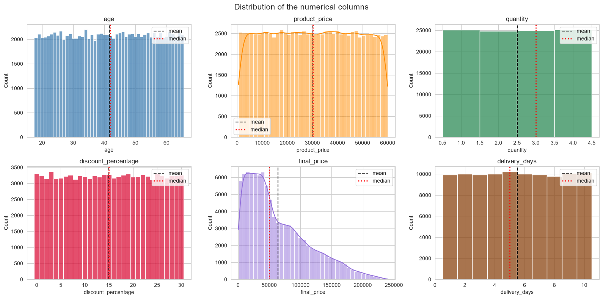
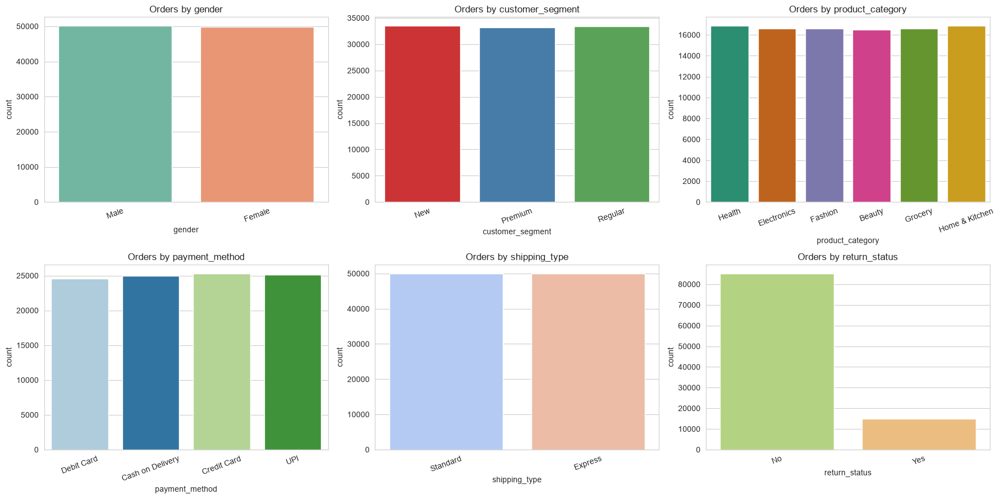
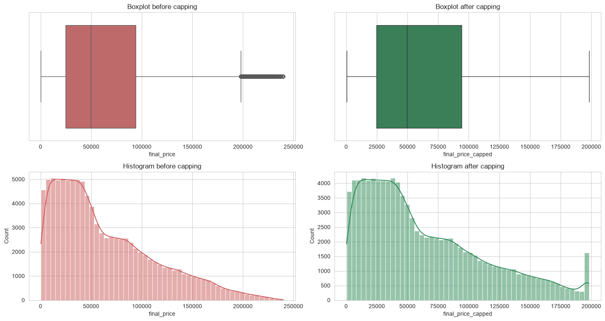
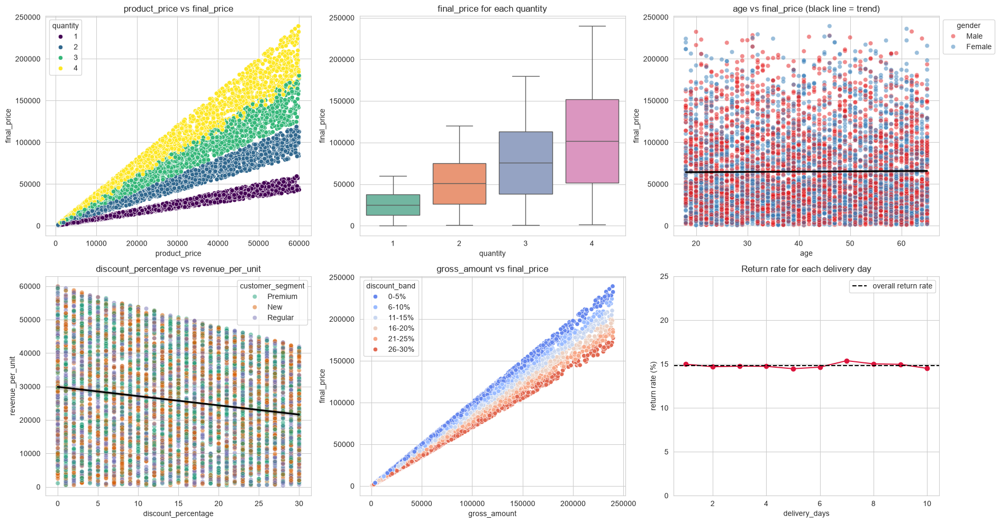
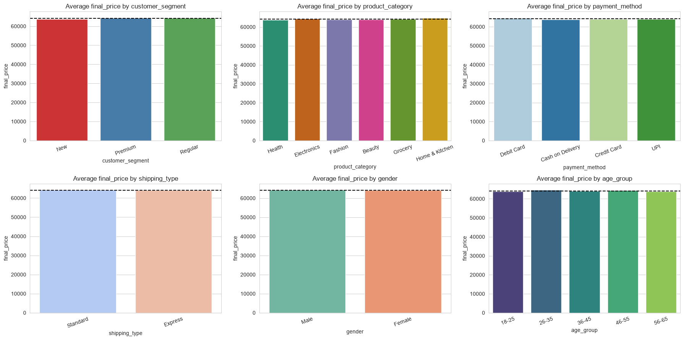
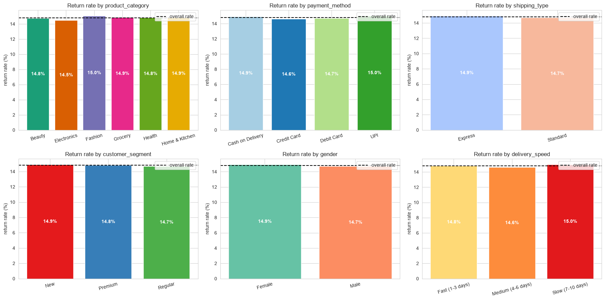
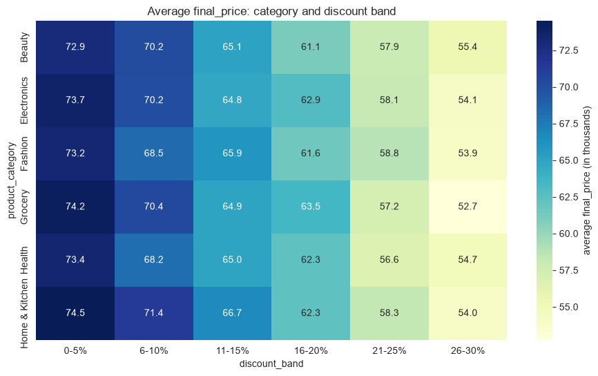
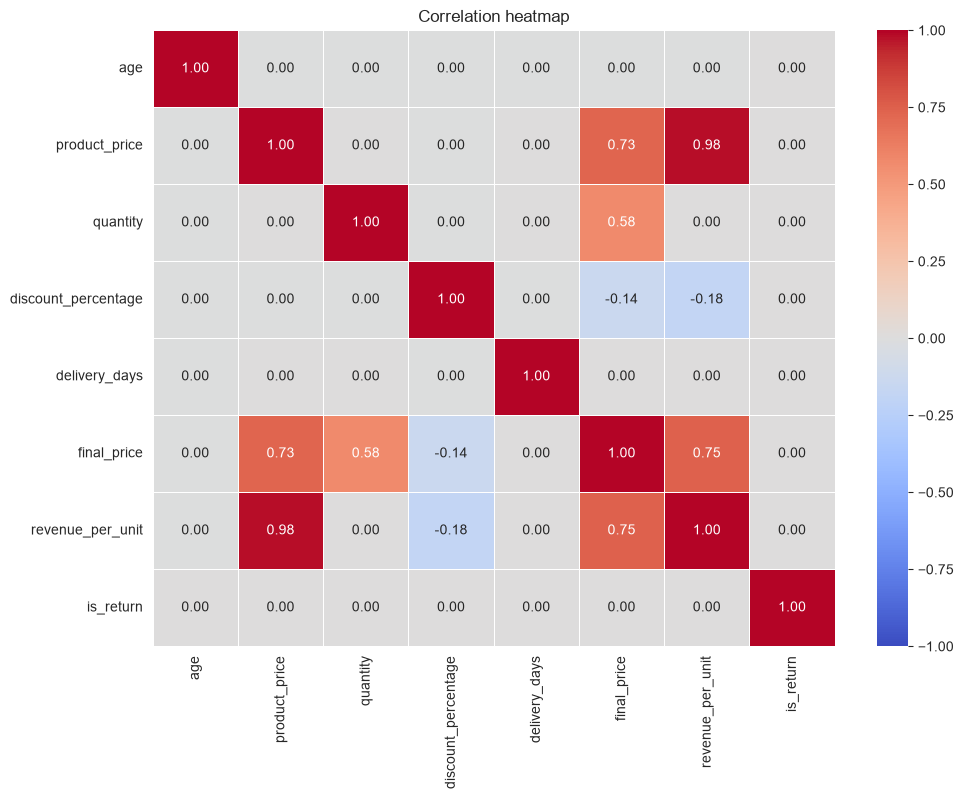
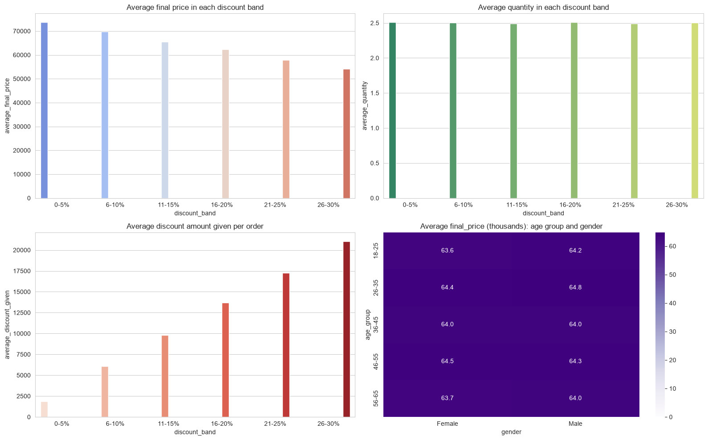
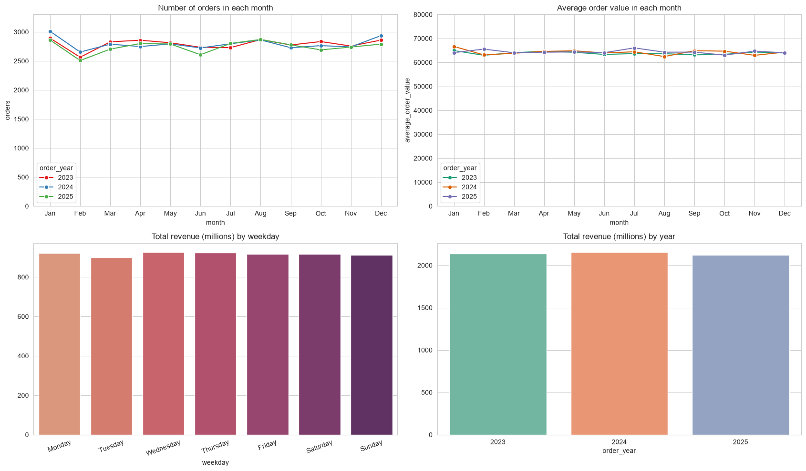

# Retail Transaction Data Analysis

Exploratory data analysis (EDA) of 100,000 retail orders, done in Python for NextHikes IT Solutions (Assignment 1).

The notebook looks at how each column behaves, how the columns relate to each other, and what stands out in the data.

## Dataset

- 100,000 orders and 18 columns, from 1 Jan 2023 to 30 Dec 2025
- Customer details (age, gender, city, state, segment), product details (category, subcategory, price), order details (date, quantity, discount, final price, payment method) and delivery details (shipping type, delivery days, return status)
- File: `data/Original_dataset.csv`

## What the notebook covers

- Univariate analysis of numerical and categorical columns
- Outlier detection (IQR and Z-score) and capping
- Bivariate analysis: numerical vs numerical, numerical vs categorical, categorical vs categorical
- Multivariate analysis and correlation heatmap
- Skewness and kurtosis
- ANOVA and chi-square tests
- Additional analysis of discounts and time trends

## Key findings

- Order value depends on price, quantity and discount, not on the customer segment, gender, age, city or payment method. Group averages are about 64,000 everywhere.
- Final price is right-skewed (skewness 0.93). Only 1,335 orders (1.3%) are outliers, and capping them changes the mean by only 0.3%.
- About 14.8% of orders are returned, and the rate is almost the same in every group.
- Express and Standard shipping both take about 5.5 days.
- Discounts cost about 15% of sales and did not raise the quantity ordered.
- There is no clear trend or seasonality over the three years.

## Selected figures

**Numerical columns**



**Categorical columns**



**Outliers before and after capping**



**Numerical vs numerical**



**Average order value by group**



**Return rate by group**



**Category, discount and average final price**



**Correlation heatmap**



**Discounts**



**Time trends**



All 26 charts are saved in `outputs/figures/`.

## Project structure

```
Retail_EDA/
├── data/                  # Original_dataset.csv and Processed_dataset.csv
├── docs/                  # Assignment brief and presentation
├── outputs/
│   └── figures/           # Charts saved by the notebook
├── Retail_EDA.ipynb       # The analysis
├── requirements.txt       # Python libraries needed
├── LICENSE
└── README.md
```

## How to run

1. Clone the repository and open the folder:

```
git clone https://github.com/Aditi020/Retail_EDA.git
cd Retail_EDA
```

2. Create and activate a virtual environment (recommended):

```
python -m venv venv
```

Windows:

```
venv\Scripts\activate
```

macOS/Linux:

```
source venv/bin/activate
```

3. Install the libraries:

```
pip install -r requirements.txt
```

4. Open the notebook and run all cells:

```
jupyter notebook Retail_EDA.ipynb
```

The notebook reads `data/Original_dataset.csv` and saves the cleaned data to `data/Processed_dataset.csv` and the charts to `outputs/figures/`. Run it from the main project folder so these paths work.

## Libraries used

pandas, NumPy, Matplotlib, seaborn and SciPy.

## Limitations

- The data looks artificially generated (flat distributions, prices unrelated to the product, no correlation between the input columns), so the results apply to this dataset only.
- Each customer has one order, so repeat purchases cannot be studied.
- There is no cost column, so revenue is not profit. The currency is also not given.
- The analysis shows relationships, not causes.

## License

This project is licensed under the MIT License. See the `LICENSE` file for details.